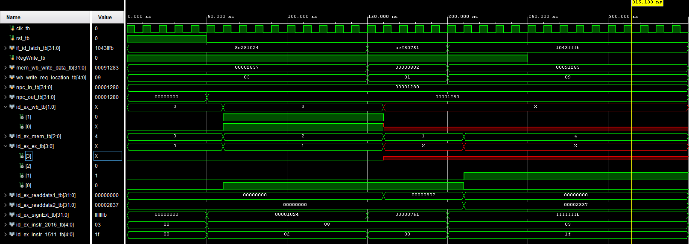

# Coding Assignment 2 - Decode

This project implements the Decode (ID) stage of a 32-bit MIPS-style five-stage pipeline. It reads an instruction from the IF/ID latch, decodes its opcode into control signals, reads the register file, sign-extends the immediate field, and transfers the resulting values into the ID/EX latch.

## Design Scope and Assumptions

* **In scope:** The control unit, 32-register file, 16-to-32-bit sign extender, ID/EX pipeline latch, and their integration in `decode.v`.
* **Out of scope:** Instruction fetch, ALU execution, branch-address generation, data memory, memory-stage forwarding, and write-back control generation.
* **Assumptions:** Instructions and data are 32 bits wide; register addresses are 5 bits; immediates are 16 bits; state updates occur on the rising clock edge; reset is active high; and the register file is initialized to zero by reset.
* **Limitations:** The implementation supports the instruction cases specified for the assignment—R-format, `lw`, `sw`, and `beq`. Unsupported opcodes receive zeroed control signals. No forwarding, hazard detection, or special handling for register 0 is implemented.

## Requirements

|Requirement|Description|Verification Method|
|-|-|-|
|REQ-01|The design shall decode R-format, `lw`, `sw`, and `beq` opcodes into the required WB, memory, and execution control fields.|`ctrl_tb.v` and `Waveforms/ctrl.png`|
|REQ-02|The register file shall write `writedata` to the selected destination when `regwrite` is asserted and shall provide the two selected register values for reading.|`regfile_tb.v` and `Waveforms/regfile.png`|
|REQ-03|The sign extender shall replicate bit 15 across the upper 16 output bits.|`signex_tb.v` and `Waveforms/signex.png`|
|REQ-04|The ID/EX latch shall capture control signals, NPC, register data, sign-extended immediate, and instruction register fields on a rising clock edge.|`idexlatch_tb.v` and `Waveforms/idexlatch.png`|
|REQ-05|The integrated Decode stage shall connect the control unit, register file, sign extender, and ID/EX latch.|`decode_tb.v` and `Waveforms/decode.png`|

## Architecture

### Timing or Behavioral Summary

The Decode stage is organized as a combinational datapath followed by a clocked ID/EX boundary:

1. `if_id_latch[31:26]` enters `control` to produce WB, memory, and execution control fields.
2. `if_id_latch[25:21]` and `if_id_latch[20:16]` select the two register-file read ports.
3. `if_id_latch[15:0]` enters `signEx` and becomes a 32-bit signed immediate.
4. The register values, immediate, instruction fields, NPC, and decoded controls are captured by `idexlatch`.

The assignment datapath is represented by the provided ID/EX design diagram:



## Implementation

### Source Code

|File|Description|
|-|-|
|[`decode.v`](decode.v)|Top-level Decode-stage integration module.|
|[`ctrl.v`](ctrl.v)|Opcode decoder for WB, memory, and execution controls.|
|[`regfile.v`](regfile.v)|32 × 32-bit register file with two read ports and one write port.|
|[`signex.v`](signex.v)|Combinational 16-bit to 32-bit sign extender.|
|[`idexlatch.v`](idexlatch.v)|Rising-edge ID/EX pipeline latch.|
|[`Testbench/decode_tb.v`](Testbench/decode_tb.v)|Integrated Decode-stage testbench.|

### Implementation Notes

* The control unit packs outputs as `{wb, mem, ex}`. The fields correspond to the assignment’s write-back, memory-access, and execution control groups.
* The register file uses asynchronous combinational reads and synchronous writes. The write occurs on the rising edge only when `regwrite` is asserted.
* The ID/EX latch is deliberately separated from the combinational Decode logic so that all Decode outputs advance together into the next pipeline stage.
* Unsupported opcodes default to zero control signals, preventing unintended writes or memory operations.

## Verification

### Verification Strategy

The design is verified using **event-driven Verilog simulation and waveform inspection**. Separate unit testbenches exercise each required module, and `decode_tb.v` exercises the integrated stage.

Verification covers:

* Normal operation for R-format, `lw`, `sw`, and `beq` instructions.
* Positive and negative 16-bit immediates for sign extension.
* Reset behavior for the register file and ID/EX latch.
* Register writes followed by reads from the written locations.
* An unsupported opcode in `ctrl_tb.v`, which should produce zero control signals.

### Testbench and Waveform

Waveform screenshots are stored in the repository’s `Waveforms/` folder.

!\[Decode-stage waveform](Waveforms/decode.png)

The integrated testbench source is available [*here*](Testbench/decode_tb.v). Unit testbenches are available for the [control unit](Testbench/ctrl_tb.v), [register file](Testbench/regfile_tb.v), [sign extender](Testbench/signex_tb.v), and [ID/EX latch](Testbench/idexlatch_tb.v).

### Results

|Test Case|Expected Result|Observed Result|Status|
|-|-|-|-|
|TC-01 — Control decode|R-format, `lw`, `sw`, and `beq` produce the specified control encodings.|Waveform shows the expected WB, memory, and execution fields for each opcode.|Pass|
|TC-02 — Register-file write/read|A value written on a clock edge is returned when its register number is selected for reading.|Waveform shows the written values on the corresponding read port.|Pass|
|TC-03 — Sign extension|Positive immediates retain zero-filled upper bits and negative immediates retain one-filled upper bits.|Waveform shows `0x00000355` and `0xFFFFF67D` for the tested values.|Pass|
|TC-04 — ID/EX capture and reset|Reset clears the latch; otherwise inputs are captured on each rising edge.|Waveform shows reset values followed by captured Decode outputs.|Pass|
|TC-05 — Integrated Decode|The stage produces register data, sign-extended immediate, decoded controls, and instruction fields at the ID/EX outputs.|Waveform shows the expected outputs for `lw`, `sw`, and `beq` test instructions.|Pass|

## Reproduction Instructions

### Tools and Versions

* **Simulator / synthesis tool:** Vivado
* **Language / standard:** Verilog HDL.
* **Operating system:** Windows, macOS, or Linux.
* **Additional dependencies:** No external libraries are required.

### Build and Run

```bash
# Run Vivado Behavioral simulation using decode_tb.v as simulation source
```

Expected output:

```text
The testbench runs through reset, register-file writes, and `lw`, `sw`, and `beq` Decode inputs. Verification is performed by inspecting the generated waveform signals.
```

## Repository Organization

```text
.
├── README.md
├── ctrl.v
├── decode.v
├── idexlatch.v
├── regfile.v
├── signex.v
├── Testbench/
│   ├── ctrl_tb.v
│   ├── decode_tb.v
│   ├── idexlatch_tb.v
│   ├── regfile_tb.v
│   └── signex_tb.v
└── Waveforms/
    ├── ctrl.png
    ├── decode.png
    ├── idexlatch.png
    ├── regfile.png
    └── signex.png
```
