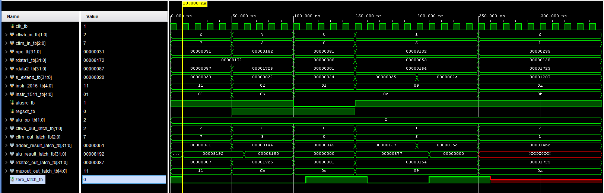

# Coding Assignment 3 - Execute

<!--
Replace every item in square brackets before submitting.
Keep this README focused on what the design does, how it is used, and how it was verified.
-->

## Design Scope and Assumptions

- **In scope:** Implement Execute stage of the MIPS, including ALU operations, ALU Control, adder, multiplexers, and ex/mem pipeline. 
- **Out of scope:** [What this lab intentionally does not implement]
- **Assumptions:** [Clock frequency, reset behavior, data width, memory model, or other assumptions]
- **Limitations:** [Known limitations or simplified behaviors]

## Requirements

| Requirement | Description | Verification Method |
|---|---|---|
| REQ-01 | The design shall decode a 6-bit function field `Instr[5:0]` alongside a 2-bit `ALUOp` signal to generate the correct 3-bit ALU control input. | [Test case, waveform, calculation, or inspection] |
| REQ-02 | The design shall provide a 32-bit multiplexer controlled by `ALUSrc` to select the second operand for the ALU: choosing `ReadData2 `(for R-type instructions) or `SignExtend` (for load, store, and immediate/branch instructions). | [Test case, waveform, calculation, or inspection] |
| REQ-03 | The design shall include an adder that combines the Next Program Counter `NPC` value with the sign-extended offset `SignExtend` to produce the branch target address `Add_Result`. | `adder_tb.v`, and `Waveforms/adder.png` |
| REQ-04 | The design shall synchronously latch all control signals (`WB`, `Mem`) and data outputs (`Add_Result`, `Zero`, `ALU_Result`, `ReadData2_ex_mem`, `FiveBitMuxout`) on the rising edge of the system clock (`CLK`) to maintain proper pipeline staging. | `ex_mem_tb.v` and `Waveforms/ex_mem.png` |

## Architecture

### Timing or Behavioral Summary

Save diagrams in the repository's `images/` folder. Use relative paths so they display on GitHub.


## Implementation

### Source Code

| File | Description |
|---|---|
| [`execute.v`](LINK_TO_IMPLEMENTATION_CODE) | Top-level Execute-stage integration module.|
| [`adder.v`](LINK_TO_COMPONENT_CODE) | 32-bit adder for branch-target address calculation.|
| [`top_mux.v`](LINK_TO_TESTBENCH_CODE) | Multiplexer that selects the destination register based on RegDst.|
| [`bottom_muc.v`](LINK_TO_TESTBENCH_CODE) |Multiplexer that selects the ALU's second operand based on ALUSrc.|
| [`alu.v`](LINK_TO_TESTBENCH_CODE) | 32-bit ALU supporting ADD, SUB, AND, OR, and SLT.|
| [`alu_control.v`](LINK_TO_TESTBENCH_CODE) | Generates ALU operation signals from ALUOp and function code.|
| [`ex_mem.v`](LINK_TO_TESTBENCH_CODE) | Rising-edge EX/MEM pipeline register storing results and control signals.|

### Implementation Notes

- [Explain one important design decision.]
- [Identify any parameterization, reusable module, or interface convention.]
- [Document any deliberate simplification made for this lab.]

## Verification

### Verification Strategy

The design is verified using **[simulation, formal checks, hardware testing, or another method]**.

Verification covers:

- [Normal operating case]
- [Boundary or maximum-value case]
- [Reset or initialization case]
- [Invalid, stalled, or exceptional case, if applicable]

### Testbench and Waveform

Waveform screenshots are stored in the repository’s `Waveforms/` folder.




The testbench source is available [*here*](Testbench/execute_tb.v). Unit testbenches are available for the [adder](Testbench/adder_tb.v), [alu_control](Testbench/alu_control_tb.v), [alu](Testbench/alu_tb.v), [bottom_mux](Testbench/bottom_mux_tb.v), [ex_mem](Testbench/ex_mem.v), [top_mux](Testbench/top_mux_tb.v).

### Results

| Test Case | Expected Result | Observed Result | Status |
|---|---|---|---|
| TC-01 — [ALU Control] | [ALUOp and function codes generate the correct ALU operation signals.] | [Waveform shows the expected control signals for ADD, SUB, AND, OR, and SLT.] | Pass |
| TC-02 — [ALU Operations] | [ALU performs ADD, SUB, AND, OR, and SLT correctly using 32-bit inputs.] | [Waveform shows the expected arithmetic and logical results.] | Pass |
| TC-03 — [Multiplexer ] | [ALUSrc selects the correct ALU operand, and RegDst selects the destination register.] | [Waveform shows the correct outputs based on the selection signals.] | Pass |
| TC-04 — [Adder] | [The adder calculates the correct branch-target address from its two inputs.] | [Waveform shows the expected 32-bit addition results.] | Pass |
| TC-05 — [EX/MEM] | [Inputs are captured and stored on each rising clock edge.] | [Waveform shows the ALU result, zero flag, destination register, and control signals being captured.] | Pass |
| TC-06 — [Integrated Execute] | [The Execute stage produces the correct ALU results, branch addresses, and EX/MEM outputs.] | [Waveform shows the expected results for the tested operations and control inputs.] | Pass |

## Reproduction Instructions

### Tools and Versions

- **Simulator / synthesis tool:** Vivado
- **Language / standard:** Verilog HDL
- **Operating system:** macOS, Windows, Linux, or other
- **Additional dependencies:** No external libraries are required

### Build and Run

```bash
Run Vivado Behavioral simulation using execute_tb.v as simulation source
```

Expected output:

```text
The testbench verifies ALU operations, branch address calculations, and EX/MEM register behavior. The results are checked using Vivado simulation waveforms. 
```

## Repository Organization

```text
.
├── README.md
├── Testbench
│   ├── adder_tb.v
│   ├── alu_control_tb.v
│   ├── alu_tb.v
│   ├── bottom_mux_tb.v
│   ├── ex_mem_tb.v
│   ├── execute_tb.v
│   ├── top_mux_tb.v
├── Waveforms
│   ├── adder_tb.png
│   ├── alu.png
│   ├── alu_top.png
│   ├── bottom_mux.png
│   ├── ex_mem.png
│   ├── execute.png
│   ├── top_mux.png
├── adder.v
├── alu.v
├── alu_control.v
├── bottom_mux.v
├── ex_mem.v
├── top_mux.v
├── execute.v
├── Testbench
```
