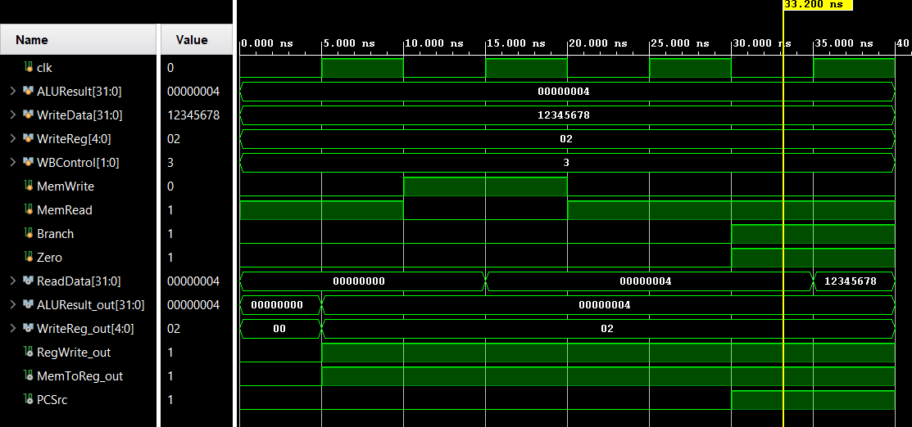

# Lab 4 — Memory and Writebnack
<!--
Replace every item in square brackets before submitting.
Keep this README focused on what the design does, how it is used, and how it was
verified.
-->
## Design Scope and Assumptions
- **In scope:** Implementation and RTL verification of the 32-bit MIPS Memory (MEM) stage, the `MEM/WB` pipeline latch, and the Write-Back (WB) multiplexer (`memory.v`), including branch decision logic (`and.v`), synchronous data memory read/write operations (`data_memory.v`), and write-back data selection (`mux.v`).
- **Out of scope:** Instruction Fetch (IF), Instruction Decode (ID), Execute (EX) ALU/adder logic, hazard detection, and forwarding units.
- **Assumptions:** 32-bit word-aligned memory addressing (`alu_result` as memory address), synchronous positive-edge triggered operations driven by a `10 ns` period (`100 MHz`) clock (`#5` half-period in `memory_tb`), preloaded memory contents from `data.mem` / `data.txt`, and 5-bit register destination addressing (`five_bit_muxout`).
- **Limitations:** Standalone stage verification using directed stimulus vectors in `memory_tb` and `And_tb` rather than full multi-stage instruction execution; Data Memory depth is bounded to the initialized simulation memory file.
## Requirements
| Requirement | Description | Verification Method |
|---|---|---|
| REQ-01 | The branch decision gate (`and.v`) shall assert `MEM_PCSrc` (`PCSrc`) if and only if both `branch` (`membranch`) and `zero` flags are high (`1`). | `memory_tb.b`, `And_tb.v`, `Waveforms/add.png` and `Waveforms/memory_tb.png` |
| REQ-02 | The Data Memory module (`data_memory.v`) shall read 32-bit words from `alu_result` when `memread` is asserted and write `rdata2out` to `alu_result` on the rising edge of `clk` when `memwrite` is asserted. | `memory_tb.b` and `Waveforms/memory_tb.png`|
| REQ-03 | The `MEM/WB` pipeline latch (`mem_wb_latch.v`) shall capture `wb_ctlout` (`MEM_WB_regwrite`, `MEM_WB_memtoreg`), `read_data`, `alu_result`, and `five_bit_muxout` on the rising edge of `clk`. | `memory_tb.b` and `Waveforms/memory_tb.png` |
| REQ-04 | The Write-Back multiplexer (`mux.v`) shall select `read_data` when `MEM_WB_memtoreg = 1` and `mem_alu_result` when `MEM_WB_memtoreg = 0` to drive `WriteData` to the Decode stage. | `memory_tb.b` and `Waveforms/memory_tb.png` |
## Architecture
### Timing or Behavioral Summary

## Implementation
### Source Code
| File | Description |
|---|---|
| [`memory.v`](memory.v) | Top-level structural module connecting Data Memory, Branch `AND` gate, `MEM/WB` latch, and WB Mux |
| [`data_memory.v`](data_memory.v) | Synchronous 32-bit Data Memory module (`memread`, `memwrite`) initialized via memory data file |
| [`mem_wb_latch.v`](mem_wb_latch.v) | `MEM/WB` pipeline register latching control signals, memory data, ALU result, and destination register |
| [`and.v`](and.v) | Combinational `AND` gate generating `PCSrc` from `membranch` and `zero` |
| [`mux.v`](mux.v) | 32-bit 2-to-1 Write-Back multiplexer controlled by `MemtoReg` |
| [`data.mem`](data.mem) / [`data.txt`](data.txt) | Initial memory contents loaded into Data Memory during simulation |
| [`Testbench/memory_tb.v`](Testbench/memory_tb.v) | Integrated stage testbench (`memoryTB`) verifying memory read, write, read-back, and branch logic |
| [`Testbench/And_tb.v`](Testbench/And_tb.v) | Standalone unit testbench (`And_tb`) verifying all 4 input combinations of the branch `AND` gate |
### Implementation Notes
- **Control Bus Splitting:** The 2-bit `wb_ctlout` bus entering `mem_wb_latch.v` is split upon exit into `MEM_WB_regwrite` (routed to the Decode stage) and `MEM_WB_memtoreg` (driving the select line of `mux.v`).
- **Modular Hierarchy:** Each datapath element (`and.v`, `data_memory.v`, `mem_wb_latch.v`, `mux.v`) is encapsulated in its own Verilog file and wired together in `memory.v` to simplify unit testing and full-CPU integration.
- **Deterministic Memory Preload:** `data.mem` and `data.txt` preload known 32-bit values at simulation start so initial `memread` cycles return predictable data prior to any write operations.
## Verification
### Verification Strategy
The design is verified using **RTL behavioral simulation in Vivado**.
Verification covers:
- **Unit-level branch logic (`And_tb`):** Exhaustively testing all four `{membranch, zero}` combinations (`11`, `01`, `10`, `00`) at `50 ns` intervals to confirm `PCSrc` only asserts when both are `1`.
- **Initial Memory Read (`memoryTB`, `t = 0–10 ns`):** Asserting `MemRead = 1` at `ALUResult = 32'h00000004` with `WBControl = 2'b11` and `WriteReg = 5'h02` to verify preloaded memory retrieval and pipeline latching.
- **Memory Write & Read-Back (`memoryTB`, `t = 10–30 ns`):** Writing `WriteData = 32'h12345678` to address `32'h00000004` (`MemWrite = 1`) for one `10 ns` clock cycle, then re-asserting `MemRead = 1` (`MemWrite = 0`) to confirm the updated value is read back.
- **Integrated Branch Assertion (`memoryTB`, `t = 30–40 ns`):** Asserting `Branch = 1` and `Zero = 1` to confirm `PCSrc` transitions high in the integrated `memory` module.
### Testbench and Waveform

The testbench source is available [*here*](Testbench/memory_tb.v).
### Results
| Test Case | Expected Result | Observed Result | Status |
|---|---|---|---|
| TC-01 — Branch Unit Truth Table (`And_tb`) | `PCSrc = 1` for `{1,1}` (`0–50 ns`); `PCSrc = 0` for `{0,1}`, `{1,0}`, `{0,0}` (`50–250 ns`) | `[Observed waveform behavior]` | Pass |
| TC-02 — Initial Memory Read (`ALUResult = 32'h00000004`) | `ReadData` outputs preloaded word at `0x04`; `RegWrite_out = 1`, `MemToReg_out = 1`, `WriteReg_out = 5'h02` after `clk` edge | `[Observed value from data.mem]` | Pass |
| TC-03 — Memory Write & Read-Back (`WriteData = 32'h12345678`) | `32'h12345678` written to `0x04` on `clk` (`MemWrite = 1`) and returned on `ReadData` when `MemRead = 1` | `ReadData = 32'h12345678` | Pass |
| TC-04 — Integrated Branch Taken (`Branch = 1, Zero = 1`) | `PCSrc` asserts high (`1`) | `PCSrc = 1` | Pass |
## Reproduction Instructions
### Tools and Versions
- **Simulator / synthesis tool:** Vivado
- **Language / standard:** Verilog HDL
- **Operating system:** macOS, Windows, Linux, or other
- **Additional dependencies:** No external libraries are required
### Build and Run
```bash
# In Vivado Tcl Console (or run Behavioral Simulation via GUI):
# 1. Add all .v source files, data.mem/data.txt, and Testbench/memory_tb.v to the simulation fileset
# 2. Set memoryTB (or And_tb) as the top simulation module
launch_simulation
run all
```
Expected output:
```text
# Simulation runs for 40 ns (memoryTB) / 250 ns (And_tb):
# At t = 25-30 ns: ReadData = 32'h12345678, ALUResult_out = 32'h00000004, WriteReg_out = 5'h02, RegWrite_out = 1, MemToReg_out = 1
# At t = 30-40 ns: PCSrc = 1
```
## Repository Organization
```text
.
├── readme.md
├── Testbench/
│ ├── And_tb.v
│ └── memory_tb.v
├── Waveforms/
│ ├── add.png
│ └── memory_tb.png
├── and.v
├── data.mem
├── data.txt
├── data_memory.v
├── mem_wb_latch.v
├── memory.v
└── mux.v
```
## Known Issues and Future Improvements
-Full Pipeline Integration: Connect MEM_PCSrc to the Fetch stage PC mux and route WriteData, mem_write_reg, and MEM_WB_regwrite back to the Decode stage and Forwarding Unit
